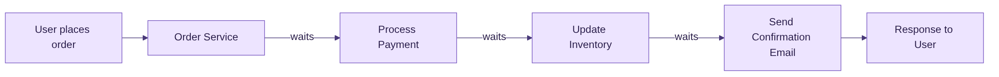
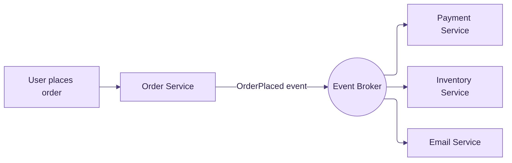
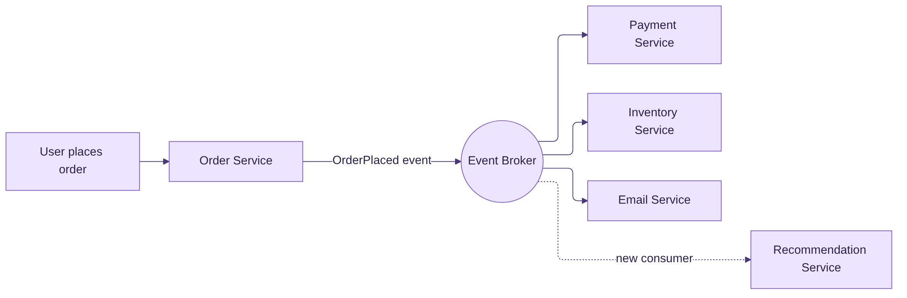

## What is Event-driven Architecture?
Event-driven architecture or EDA is a software design pattern where the system produces and responds to events. The fundamental concept of responding to an event or a text input is not new, and has been used from early 1970s. Lets understand what an event actually means.

## What is an event?
An event is a change in state, the significance of the change depends on the domain of the system, hence it can be defined as **significant change** in state.
An example of event could be
- An order was placed
- A payment was processed
- A file was uploaded
- A transaction was received

> [!NOTE]
> The event itself is not the notification message, but as EDA is designed on top of message-driven architectures, an event and the notification message mean the same.

## The need for event-driven architecture
The best way to understand this is with an example. For an ecommerce platform selling anime merchandise, the basic user workflow would be a user makes a purchase, the payment should be processed, the inventory needs to be updated, a confirmation email should be sent. In a monolithic architecture, this would look like this

Every step waits for the previous one to finish, and the user is waiting at the end of all of it.

But if the system is event-driven, each service can act independently and complete based on its process time.

The order service only has one job now, publish the `OrderPlaced` event and respond back to the user. It does not know (or care) who is listening.

This allows a seamless user experience, because assuming the email confirmation service fails, the payment still gets processed and inventory is also updated. In case of the monolithic system, one point of failure would cause the whole system to fail.

Now if I want to send the cart details to a recommendation system, I can easily add a new service to in the event-driven system whereas, in the monolith, as the whole system is dependent, adding there would be more time consuming to build and test.

Notice that the order service did not change at all. The new consumer just subscribes to the same event and starts receiving it.

When a system needs
- fan-out (multiple consumers for the same event)
- loose coupling between producer and consumers
- better scalability
- fault isolation
- asynchronous processes

you can think of making it event-driven.

## Not all events are the same
When people say "event-driven", they might be talking about very different things. Martin Fowler explains this well in his article [What do you mean by "Event-Driven"?](https://martinfowler.com/articles/201701-event-driven.html), where he breaks it down into four patterns -

- **Event Notification** - The producer just announces that something happened (`OrderPlaced`) and does not expect any response. If the consumer needs more details, it calls back the producer.
- **Event-Carried State Transfer** - The event itself carries the data the consumers need, so they don't have to call back the producer. Consumers keep working even if the producer is down, but the same data now lives in multiple places.
- **Event Sourcing** - Every change in state is stored as an event, and the log of events becomes the source of truth. You can rebuild the current state (or any past state) by replaying the events.
- **CQRS** - Separate models for writing and reading the data. It is often used with events, but does not need them.

Most of the systems, including the examples in this blog, use the first two. Knowing which one you are using makes the design discussions a lot easier.

## The other side of EDA
Event-driven architecture is not a silver bullet. There are a few things which become harder once you go event-driven -

- **Hard to see the full flow** - In the monolith, you can read the code top to bottom and understand the workflow. In an event-driven system, the flow is spread across producers and consumers, and often you can only understand it by monitoring the running system.
- **Debugging** - Tracing a single order across multiple services and their logs is harder than reading one stack trace.
- **Eventual consistency** - The inventory might get updated a few seconds after the payment is processed. Your system (and business) should be okay with that.
- **Duplicate events** - With retries, the same event can be delivered more than once, so consumers should be idempotent i.e. processing the same event twice should give the same result.
- **Not for everything** - If you need an immediate response or ultra-low latency, a direct synchronous call is still the better choice.

None of these are a reason to avoid EDA, but you should go in knowing about them.

## EDA on AWS
Due to the advancements in cloud infrastructure, it has become easier to setup a event-driven system's infrastructure needs. AWS is one of the top 3 cloud providers and also the leading one by market share. Similar equivalent services can also be found on the other cloud providers, but my experience lies with AWS.

For any event-driven system, there needs to be a event producer/consumer and an event broker channel.
In AWS, an event producer can be anything that generate events-
- APIs
- Applications
- Lambda functions
- Data pipelines
- Any application outside AWS

For event routing -
- Simple Notification Service (SNS)
- Simple Queue Service (SQS)
- EventBridge

For event streaming -
- Kinesis Streams

An actual production implementation of event-driven system would probably use all of these services in one way or another.

For example, the combination of SNS & SQS is more powerful than using just either one of the service as a broker. SNS brings the flexibility to add more consumers without changing the producer code, making the system less coupled. While SQS adds the reliability of retrying, without writing any code.

To understand why, look at what each one lacks on its own. With only SQS, the producer has to know about every queue and send the message to each of them, so adding a new consumer means changing the producer. With only SNS, if a consumer fails while processing, the message is gone, there is no retry. Put them together, with SNS publishing to one SQS queue per consumer, and you get the best of both. The producer publishes once, each consumer reads from its own queue at its own pace, and if one consumer keeps failing, the others are not affected at all. This is nicely explained in [SNS & SQS: A Match Made in the Clouds](https://medium.com/slalom-build/sns-sqs-a-match-made-in-the-clouds-c4a53989e007).

EventBridge is a serverless event bus service, which allows to add rules to implement routing logic based on content of the message, allowing to filter and transform incoming messages to multiple targets. EventBridge and SNS have a lot of similarities and can be used interchangeably in the architecture based on their few differences.

Kinesis Stream is used to capture data in real time from various sources as a continuous stream of events, allowing to do real-time processing and analysis. The key deciding factor for choosing Kinesis Stream vs the other 3 (SNS, SQS, EventBridge) is to have a high-throughput low latency processing system with replaying capabilities.

To put it simply -

| Need | Service |
| :--- | :--- |
| Push the same event to many consumers | SNS |
| Buffer events and retry on failure | SQS |
| Route events based on their content | EventBridge |
| High-throughput ordered stream with replay | Kinesis Streams |

## Serverless is the way to go! (at first)
When adopting event-driven architecture, using serverless services let you start fast and safely.
Early on, the ability to build and ship faster is more important than spending time to provisioning all the infrastructure.

AWS provides some reliable serverless services which can be utilized for an EDA system, few of them which we discussed above.

AWS Lambda is a compute service which is serverless and event-driven (allows to be triggered based on events) without provisioning or managing servers. I have found this service to be super powerful when architecting in an event-driven system, and so should be the case for most of the systems built using AWS.

To summarize, serverless helps you solve the business problem first, instead of the infrastructure problem. You pay only for what you use, AWS takes care of the scaling, and there are no servers sitting idle at night when no events are coming in.

Why "at first" though? Because serverless is not free of trade-offs. Lambda has a 15 minute execution limit, cold starts can add latency, and at a very high and constant volume of events, paying per invocation can become costlier than running your own containers or servers. Once your system grows and the traffic pattern becomes predictable, it is worth revisiting the choice. But until then, serverless will take you a long way.

## Putting it all together - A real example
To try all of this hands-on, I built a small project - [aws-serverless-pos-transactions](https://github.com/omingale0707/aws-serverless-pos-transactions). It simulates point-of-sale (POS) transactions of a clothing store, and processes them through an event-driven pipeline built entirely on serverless AWS services.

Here is how an event flows through the system -

1. **Producer** - The POS servers in the stores (simulated by a python script) put each transaction into a **Kinesis stream**. The store id is used as the partition key, so transactions of a store stay in order.
2. **Validation** - A **Lambda** function is triggered by the Kinesis stream in batches. It validates every transaction and publishes it to one of the two **SNS topics** - `valid-transactions-topic` or `invalid-transactions-topic`.
3. **Fan-out** - The valid topic has two **SQS queues** subscribed to it. Each queue feeds its own consumer, so both get a copy of every valid transaction.
4. **Consumer 1** - A Lambda reads from the first queue and saves the transactions as compressed json files in an **S3 bucket**. These can be used for archival, reconciliation, etc.
5. **Consumer 2** - Another Lambda, running inside a private VPC, reads from the second queue and loads the transactions into an **RDS Postgres** instance in near real-time (3-5 seconds). Any application can now use this data to understand real-time sales and other metrics.

If you map this back to what we discussed above, you can see each concept in action -
- **Kinesis** for capturing a continuous stream of transactions from multiple stores
- **SNS + SQS** for fan-out with reliability. The S3 saver and the RDS loader don't know about each other, and if the RDS loader fails, the transactions still get saved in S3.
- **Lambda** as the compute for every step, without managing a single server
- **Adding a new consumer** is just one more SQS queue subscribed to the valid topic. The validator Lambda does not change at all. Same goes for the invalid topic, which can be subscribed to for alerting or investigation.
- **Event-Carried State Transfer** - The event carries the complete transaction, so the S3 saver and the RDS loader never have to call back the producer to get the details.

The whole infrastructure is written in Terraform, so you can bring it up with `terraform apply`, play around with the publisher script (number of stores, transactions per second, percentage of invalid transactions), and destroy it all when done.

> [!WARNING]
> Some of the services used in this project will cost you, though a small amount. Make sure to run `terraform destroy` and keep an eye on your AWS bill.

This project is by no means at production level. Few things I would add before calling it production-ready -
- Dead Letter Queues (DLQs) for the SQS queues, so the failed messages are not lost
- RDS Proxy and connection pooling, as many Lambdas opening connections can easily overwhelm the database
- Secrets Manager for the database credentials and stricter IAM policies

## Conclusion
Event-driven architecture is not something new, but cloud services have made it much easier to adopt. If your system needs fan-out, loose coupling, fault isolation or asynchronous processing, it is worth considering.

On AWS, start with the serverless building blocks - SNS, SQS, EventBridge, Kinesis and Lambda. Pick them based on what your events need, and not because one is more popular than the other. Start small, ship fast, and revisit your choices as the system grows.

If you want to see these pieces working together, check out the [project on GitHub](https://github.com/omingale0707/aws-serverless-pos-transactions), clone it and try it out yourself.

## References
- [What is EDA (Event-Driven Architecture)? - AWS](https://aws.amazon.com/what-is/eda/)
- [What do you mean by "Event-Driven"? - Martin Fowler](https://martinfowler.com/articles/201701-event-driven.html)
- [SNS & SQS: A Match Made in the Clouds - Slalom Build](https://medium.com/slalom-build/sns-sqs-a-match-made-in-the-clouds-c4a53989e007)
- [aws-serverless-pos-transactions - GitHub](https://github.com/omingale0707/aws-serverless-pos-transactions)
